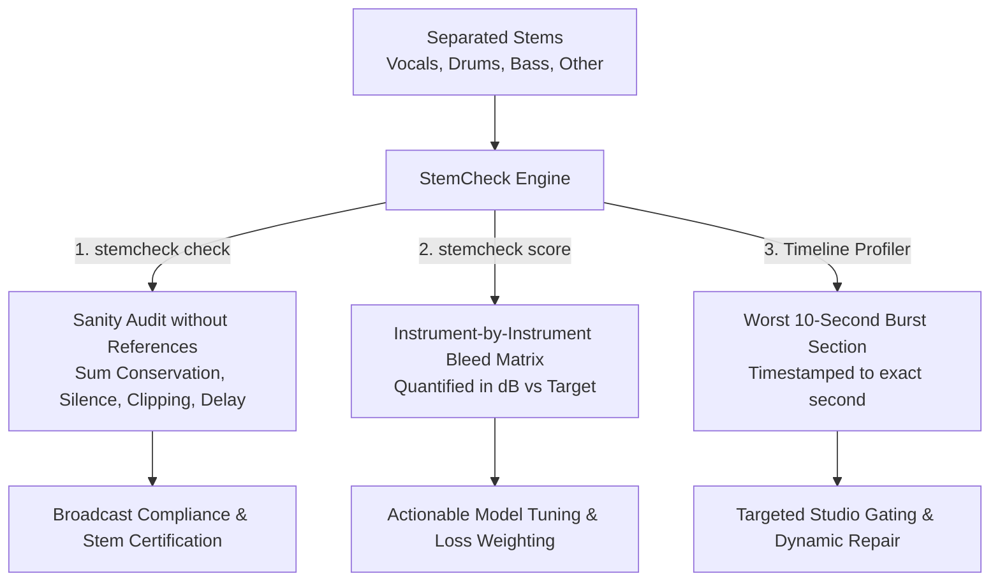

# StemCheck: Problem, Solution & Strategic Market Edge
**Entity:** ComposerMind Labs  
**Author:** Boobalan Arjunan  
**Focus Area:** Music Source Separation Quality Assurance & Bleed Diagnosis  

---

## 1. The Core Problem: The Blindness of Global SDR Metrics

For over a decade, the audio machine learning community has evaluated source separation algorithms using global Signal-to-Distortion Ratio (SDR) metrics from toolkits like `museval`. 

While SDR provides a single global number (e.g. "Vocal SDR = 9.2 dB"), it is an **opaque black box** with critical diagnostic blind spots:
1. **Zero Source Attribution:** If an SDR score drops by 3 dB, SDR cannot tell you *why*. Did the drum kit bleed into the vocal track? Did the bass synthesizer leak? Or did the neural network introduce robotic phase artifacts?
2. **Global Averaging Masks Acute Burst Bleed:** A vocal track might be perfectly isolated for 90% of a song, but during the chorus drum solo, the snare drum might leak catastrophically at $-12\,\text{dB}$. Global SDR averages this out, hiding the exact moment the audio was ruined.
3. **No Sanity Checks for Production Delivery:** In real-world audio distribution (remixing, karaoke, Dolby Atmos stem delivery), audio engineers need to know basic sanity rules: *Do these stems sum back up to the master track without clipping or phase cancellation?* SDR cannot answer this.

---

## 2. The StemCheck Solution: Decomposed Bleed Matrices & Temporal Timelines

StemCheck introduces **Decomposed Instrument Bleed Diagnosis**:



### Strategic Innovations:
1. **Instrument Bleed Matrix:** Explicitly breaks down cross-talk (e.g. `Vocals: -26.4 dB from drums, -38.1 dB from other`).
2. **Measurement Floor Guard:** Employs statistical phase randomization to compute the chance correlation floor, ensuring that instruments playing in the same harmonic key are not falsely accused of bleeding.
3. **Temporal Timeline:** Produces `timeline.csv` marking every 10-second segment of the track, pinpointing the exact timestamp where bleed peaks.

---

## 3. Position in the ComposerMind Labs Ecosystem

StemCheck completes the closed-loop evaluation cycle:

```
[WaveWash]   --> Cleans raw dataset audio
[SplitSafe]  --> Certifies train/test partition independence
[Mix-Forge]  --> Synthesizes ground-truth test mixes with known bleed
[StemCheck]  --> Measures bleed and diagnoses separation model accuracy
```

---

## 4. Verification Standard
- **Unit Test Coverage:** 78/78 tests passing.
- **Signal Integrity:** Pure Python signal processing via `scipy` and `numpy`.
